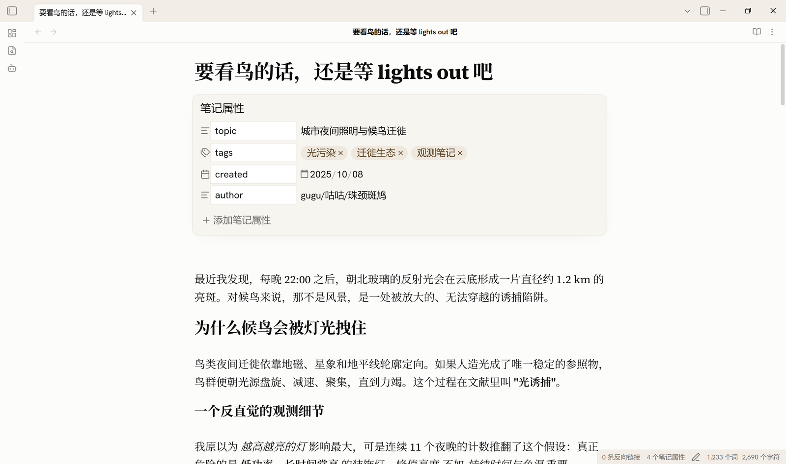
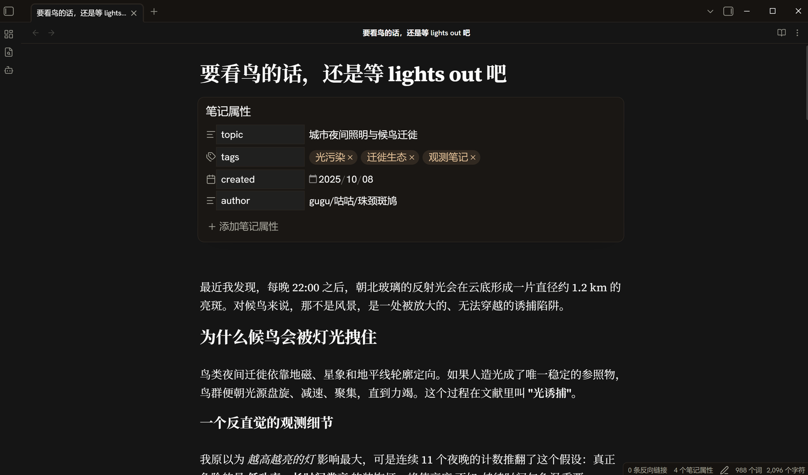
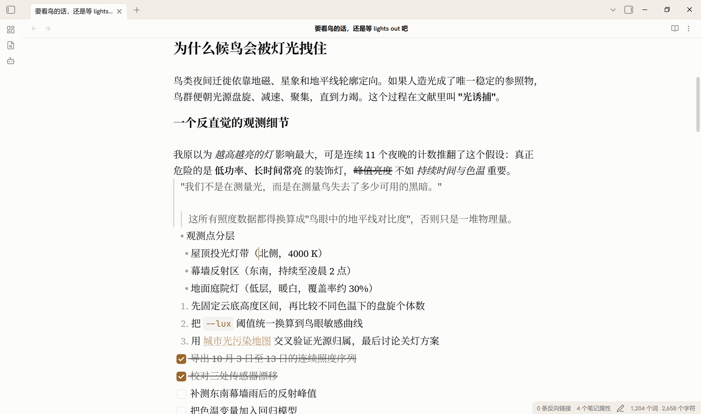
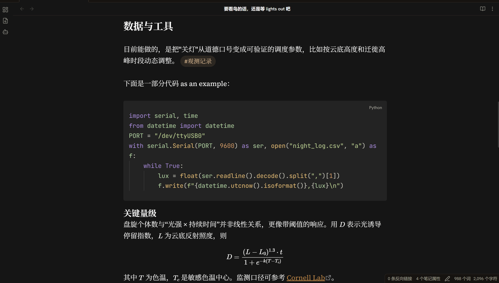
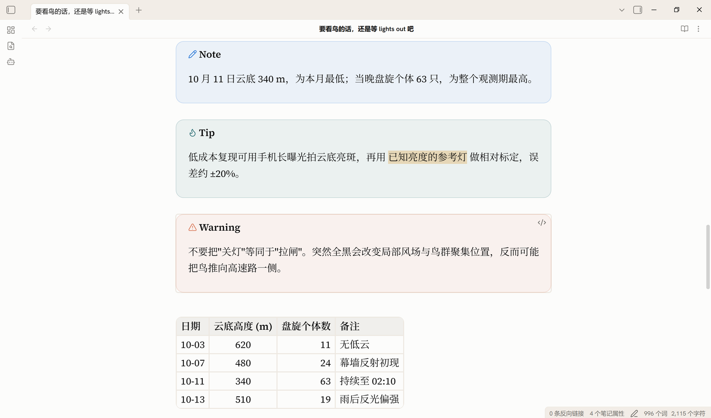
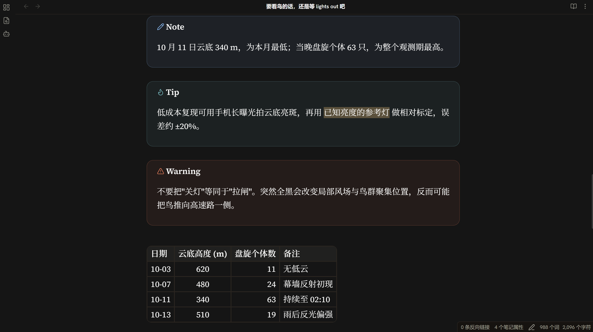
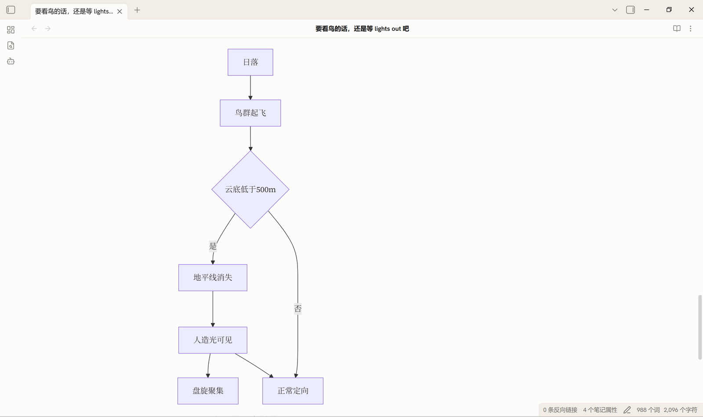
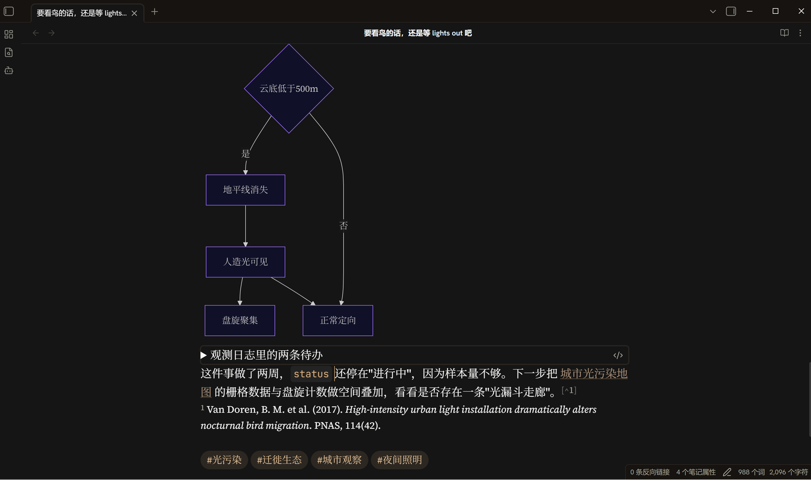
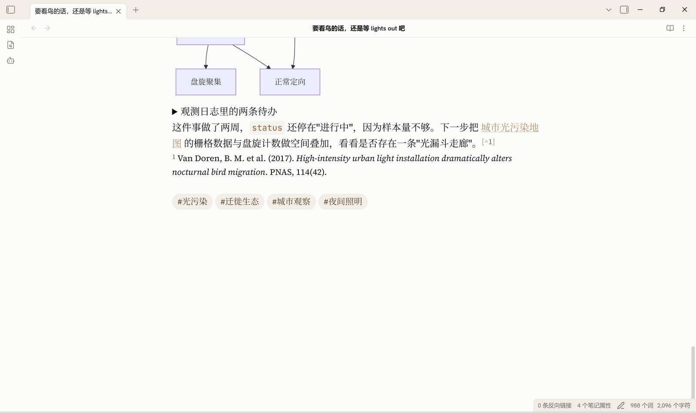

# Space to think

A warm, quiet Obsidian theme. Ivory reading surface, a slightly deeper
parchment chrome layer, warm hairlines instead of shadows, and a single
muted brown-gold accent.



## Screenshots

| Light | Dark |
|---|---|
|  |  |
|  |  |
|  |  |
|  |  |
|  | |

## Design

**Two planes.** Content sits on `--background-primary`; everything that frames
it — titlebar, ribbon, tab bar, both sidebars — sits on `--background-secondary`.
They are separated by a 1px warm hairline rather than a shadow, so the window
reads as one continuous sheet of paper with a slightly deeper frame.

**A welded active tab.** The active tab has left/top/right borders, no bottom
border, and `margin-bottom: -1px`, so it opens into the pane below instead of
floating as a separate box.

**One muted accent.** A desaturated brown-gold, `#99672e` in light mode and
`#d7ab79` in dark. Because the dark accent is a *light* colour,
`--text-on-accent` flips to dark ink in dark mode — the same token drives the
checkbox tick, so it stays visible either way.

## Colours

| Role | Light | Dark |
|---|---|---|
| Reading surface | `#fcfcfb` | `#151515` |
| Chrome | `#f2ede7` | `#161310` |
| Hairline | `#ede8e1` | `#2a2520` |
| Body text | `#0b0b0b` | `#fcfcfb` |
| Accent | `#99672e` | `#d7ab79` |

## Fonts

Three typefaces are **embedded directly in `theme.css` as base64**, so the theme
renders as designed with no network access and no font installation.

Obsidian injects theme CSS as *text* into a `<style>` element rather than
linking it, so relative `url()` paths cannot resolve inside a theme. Embedding is
the only reliable option — which is also why other font-carrying community themes
inline theirs.

The stacks still front-load the commercial typefaces this design was drawn
against, so anyone who owns them gets them automatically:

- **UI:** Styrene B → *Hanken Grotesk* (embedded) → system sans
- **Reading:** Tiempos Text → *Source Serif 4* (embedded) → Georgia → serif
- **Code:** Söhne Mono → Berkeley Mono → *JetBrains Mono* (embedded) → monospace
- **CJK:** Noto Serif SC → Source Han Serif SC → 思源宋体 → system CJK sans

The embedded faces are SIL OFL 1.1 licensed and may be redistributed. Their
license texts are in [`fonts/LICENSE-OFL.txt`](fonts/LICENSE-OFL.txt); the
original `.woff2` files are kept in `fonts/` so the embedded data can be
verified. Neither is loaded at runtime.

**CJK note.** Chinese/Japanese/Korean prefers a proper CJK serif when one is
installed, so the two scripts share a voice. It deliberately does *not* fall
back to Songti or SimSun, which render too thin on screen — when no CJK serif is
present the text uses the system CJK sans instead. Nothing is bundled for CJK;
only family names are referenced, so no CJK font is redistributed.

The interface keeps a sans stack, so the file explorer and menus stay in the
system UI face while note text is set in a serif. That split is intentional.

## Installation

1. Download this folder.
2. Drop it into `<your vault>/.obsidian/themes/Space to think/`.
3. Obsidian → Settings → Appearance → Theme → **Space to think**.

Or, once it is in the community list: Settings → Appearance → Manage → Browse →
search "Space to think".

## Notes

- Set Obsidian's window frame style to **Custom frame** or **Hidden** if you
  want the `.titlebar` rules to apply; with the native frame there is no
  `.titlebar` element and nothing changes.
- The theme ships no Style Settings block. The palette is intentionally fixed;
  edit the two `.theme-light` / `.theme-dark` blocks at the top of `theme.css`
  to retune it.

## Credits

Written from scratch: the stylesheet was authored for this theme rather than
derived from an existing one. The palette and the two-plane chrome idea were
arrived at after studying Claude's own desktop interface alongside several warm
community themes — notably **Claude Warm** by **Amo**. That is a debt of
inspiration, not of code.

Bundled typefaces — **Hanken Grotesk**, **Source Serif 4** and
**JetBrains Mono** — are by their respective authors and licensed under the
[SIL Open Font License 1.1](https://scripts.sil.org/OFL). See
[`fonts/LICENSE-OFL.txt`](fonts/LICENSE-OFL.txt).

## Submitting

Everything in this repository is ready. The remaining step is a PR against
[`obsidianmd/obsidian-releases`](https://github.com/obsidianmd/obsidian-releases)
that adds this entry to `community-css-themes.json`:

```json
{
  "name": "Space to think",
  "author": "gugu",
  "repo": "guguthecoder/obsidian-space-to-think"
}
```

## License

MIT — see [LICENSE](LICENSE). The three embedded typefaces are **not** covered
by that grant; they remain under the SIL OFL 1.1, reproduced in
[`fonts/LICENSE-OFL.txt`](fonts/LICENSE-OFL.txt).
